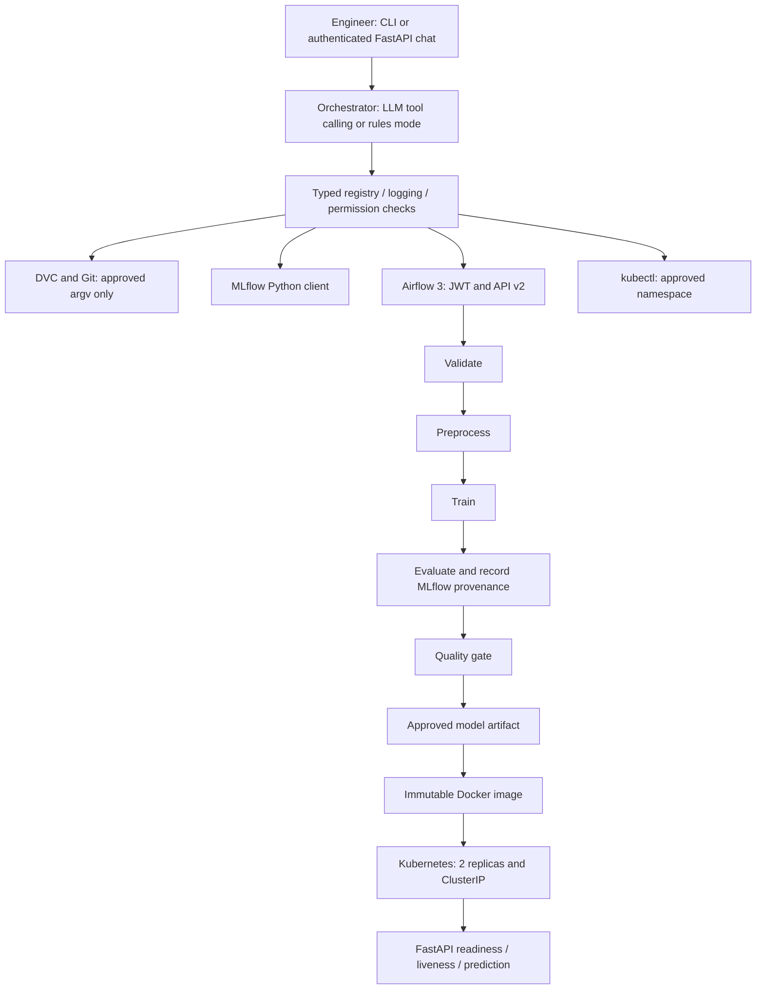

# Architecture and operational contract

The workstation operator uses local DVC/Git, HTTP to MLflow/Airflow, and kubectl
with the user's explicitly configured context. Inference is independent of control
plane credentials. The five training stages run either through `dvc repro` or the
Airflow DAG with identical Python functions. Shared artifact files require one
training execution at a time; Airflow enforces one active DAG run. A production
implementation should isolate run-specific artifact directories.

## Tools and permissions

| Integration | Read tools | Mutation tools / controls |
|---|---|---|
| DVC | list, version, status, compare | No conversational checkout; reproduction uses a separate worktree. |
| MLflow | experiments, runs, run details/artifacts, best, compare, registry | Training writes experiments; the conversational tools are read-only. |
| Airflow 3 | DAGs, runs, task instances, task logs | Trigger only `training_pipeline`, after a reviewed single-use confirmation. |
| Kubernetes | workloads, services, events, application pod logs | Restart only `iris-api` in `mlops-agent`, after a reviewed single-use confirmation. |

Every registry tool has a generated Pydantic JSON schema; unknown tools and extra
arguments fail validation. A caller cannot supply the internal `confirmed` flag.
Confirmation binds exact arguments to a random five-minute token, independent of
LLM output. Namespace and DAG checks execute again in the tool itself. No shell
execution, arbitrary Python execution, or arbitrary kubectl argv are exposed.

Structured logs contain tool name, status, duration and request UUID. Exception
messages are suppressed to prevent credential leakage; returned evidence is
redacted for configured credentials and common token/password patterns. Redaction
cannot guarantee removal of arbitrary secrets in free-form application logs, so
review exported evidence before publishing. Chat requires a locally generated API
key and should bind to localhost. Simple Airflow auth and SQLite MLflow artifact
storage are local demonstration choices; use proper auth, TLS, shared storage and
restricted identities for a real multi-user deployment.

## Provenance and reasoning

The actual dataset MD5 must match both the local DVC pointer and the pointer in
the recorded Git commit before evaluation can log a run. Run tags link metrics to
that commit/hash. Best-model selection is scoped to the latest requested N runs,
excludes incomplete runs and missing/non-finite metrics, and supports min/max.
Metric ranking is a candidate recommendation; deployment readiness, lineage and
the quality gate are checked separately. A Kubernetes deployment image is tagged
by run ID and its pod template records the run ID for correlation.

Rules mode produces facts, unknowns and recommendations from retrieved data. LLM
mode chooses tools using structured calls and receives the same error/safety
semantics. Its explanations can still be imperfect; evidence is returned separately
for review. When all tools fail, a deterministic response replaces any unsupported
provider narrative. No operational knowledge is supplied as a fabricated result.
The explicit 30-day freshness policy and failed gate can justify recommending
retraining; deployment outages alone do not establish model degradation.

## Sources used for API implementation

- [Airflow 3 public API authentication](https://airflow.apache.org/docs/apache-airflow/stable/security/api.html)
- [Simple auth manager token generation](https://airflow.apache.org/docs/apache-airflow/stable/core-concepts/auth-manager/simple/token.html)
- [Airflow 3.1.1 REST API](https://airflow.apache.org/docs/apache-airflow/3.1.1/stable-rest-api-ref.html)
- [MLflow tracking server architecture](https://mlflow.org/docs/latest/self-hosting/)
- [OpenAI function calling](https://developers.openai.com/api/docs/guides/function-calling)

Versions are pinned in `pyproject.toml` and container definitions. Airflow runs on
Linux in Docker rather than a native Windows environment. The local Python virtual
environment supports Python 3.11/3.12; use 3.12 for the supplied walkthrough and CI.
